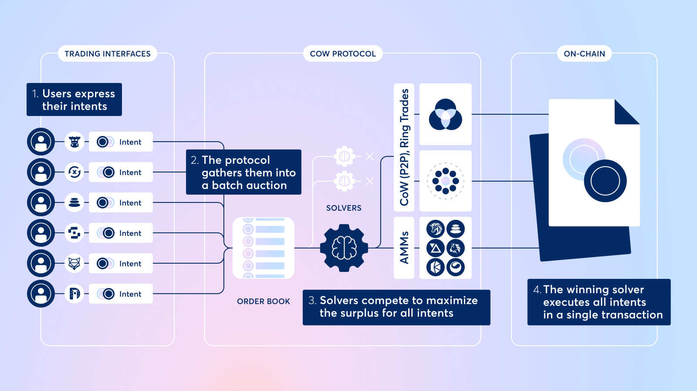
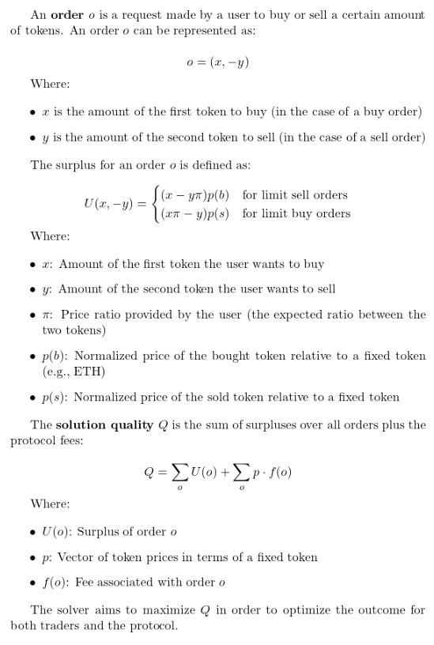
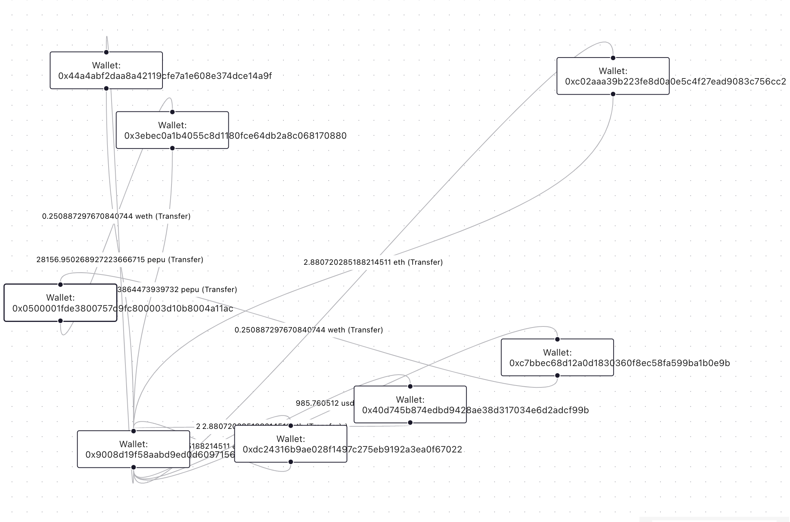

# Automated Batch Auction Solver for CoW Protocol

## Motivation

In traditional finance, orders are typically collected in order books. Think of stock exchanges or futures markets. A trade happens whenever a buy order of one token is matched by a sell order of the other, i.e., if there exists an exchange rate that satisfies the limit prices stated in the respective orders.

However, decentralized finance (DeFi) presents a unique challenge. Instead of trading in US Dollars, for example, there are hundreds of thousands of different tradable tokens. In such a setting, one separate order book is required for every token pair combination. This may significantly limit liquidity for less frequently traded token pairs and lead to large bid-ask spreads and low trading volumes.

One solution to this problem is the batch auction. Orders are collected into a batch and executed at once in discrete time intervals. This leads to greater liquidity and removes arbitrage opportunities, yielding benefits to all users of batch auction protocols.

## Background on CoW Protocol and Solvers

### What is the CoW Protocol?

The **CoW Protocol** (Coincidence of Wants Protocol) is a decentralized system for trading crypto assets efficiently and securely. It connects users with matching trade needs directly or combines trades to minimize costs, avoiding the need for traditional intermediaries like exchanges.

Rather than placing orders by signing a raw transaction that executes directly on-chain (i.e. as happens on Uniswap or SushiSwap), CoW Protocol users place orders by signing an "intent to trade" message that specifies parameters like the assets and amounts they would like to trade. The intent is a signed message which allows the solvers to execute a trade on behalf of the user using their specified assets and amounts.

There are a number of financial and technical advantages to intent-based trading. When a user places a trade directly on-chain, the execution path is set in stone and the trader receives whatever price (+/- slippage) the AMM or aggregator they're trading on gives them. In contrast, batch auction protocols such as CoW group and process many intents together to find optimal matches and execution paths, which reduces transaction costs.

Thanks to its intent-based architecture, CoW Protocol delegates the job of finding the optimal execution path to professional third parties known as solvers. Solvers not only scan all available on-chain liquidity (similar to a DEX aggregator) they also provide extra price improvements in several ways:

- **Coincidence of Wants (CoW)**: Direct P2P (peer-to-peer) matching for two or more users who have expressed opposite buy and sell intents for the same token pair. This optimization, enabled by batch auctions, allows users to bypass liquidity provider (LP) fees and reduces the gas fees for trading as orders don't need to interact with more smart contracts.
- **Private Market Maker Inventory**: Many solvers have access to off-chain liquidity, integration with private market makers, or private liquidity of their own. This allows them to fill certain trades at better prices than what may be available through on-chain AMMs at any given time.
- **MEV (Maximum Extractable Value) Protection**: MEV refers to the profit that miners, validators, or arbitrageurs can extract by reordering, including, or excluding transactions within a block before it's finalized. CoW Protocol, users are never exposed to MEV bots. Instead, solvers settle trades on behalf of the user, taking on all MEV risk. In addition, solvers submit all orders in a batch at a uniform clearing price, meaning there is no advantage to re-ordering trades (the basis of all MEV exploitation).

### What Exactly Are Solvers?

**Solvers** are entities within the CoW Protocol that compete to execute trades in the best way possible. When you submit a trade request, Solvers:

1. Analyze available trading options.
2. Consider all markets and matching opportunities.
3. Propose the most cost-effective solution.

For each batch auction, there is a competition between the active solvers to find the best optimization for the same objective function (maximizing "surplus" across the executed trades, see Technical Details section below). The Solver that finds the optimal set of trades/transfers wins and executes their solution, ensuring efficiency and fairness. The Solver that wins is rewarded by the CoW protocol in COW tokens, incentivizing them to compete to find better prices and win the right to execute user intents.

### Why Are Solvers Important?

- **Optimal Pricing**: They ensure you get the best price by exploring all available paths.
- **Reduced Costs**: Solvers optimize trades to minimize fees and maximize value.
- **Competition-Driven**: Multiple Solvers competing ensures the best solution is chosen.

By integrating batch auctions and leveraging Solvers, the CoW Protocol delivers a robust and innovative framework for best price crypto trading.

### CoW Protocol Order Flow



---

## Project Overview

Our project focuses on creating our own solver from scratch, using Rust and hosted on Heroku, and entering the solver competition, in order to facilitate trades as specified by the CoW Protocol. Our solver matches orders to available liquidity, choosing efficient and consistent clearing prices to guarantee a fair and efficient batch auction.

Additionally, we created a JavaScript visualization to display solutions created by our solver or other people's solvers. This will provide a clean overview of what a solver deemed to be the most fair and surplus-maximizing solution for a batch auction.

---

## Technical Details

### Surplus Calculation, Objective Function, and Clearing Prices



An interesting requirement of batch auctions is the enforcement of uniform clearing prices.

Let $\tau_i, \tau_j, \tau_k$ be tradeable tokens. The pairwise exchange rates between two tokens $\tau_j$ and $\tau_k$ will be denoted by $p_{j|k}$ , meaning the price of one unit of $\tau_j$ measured in units of $\tau_k$.

Uniform clearing prices means that the price to swap tokens $\tau_i$ and $\tau_j$ are the same for every person in that batch. Additionally, it means that
$$p_{i|k}=p_{i|j}\cdot p_{j|k}$$ for any tokens $\tau_i, \tau_j, \tau_k$.
Determining the best clearing prices is the key to maximizing surplus and winning the solver competition.

There are a variety of strategies for order matching in order to maximize the surplus function, and while we implemented some simple ones there are more complex ways to solve the problem with multidimensional CoWs and intermediate trades. The strategies that we implemented are outlined below:

### Provided Liquidity Immediate Matching (Luke's Solver)

### Gecko Terminal Best On Chain Liquidity Solver (Philip's Solver)

This solver uses the [GeckoTerminal API](https://www.geckoterminal.com/dex-api) to fetch liquidity pools hosted on multiple decentralized exchanges (DEXs) containing the relevant token pair in each order. The solver assumes that the lowest-fee liquidity pool has the best clearing price for each token pair.

Let $\tau_i$ be the token to be bought and $\tau_j$ be the token to be sold. Each order specifies nonnegative amounts $\bar{x}, \bar{y}$, where $\bar{x}$ is the maximum amount of $\tau_i$ to be bought and $\bar{y}$ is the maximum amount of $\tau_j$ to be sold.

It then calculates the maximum amount of tokens that can be traded using the following formulas. Let $p_{i|j}$ be the number of $\tau_j$ you would buy for selling one $\tau_i$. Define $p_{j|i}$ correspondingly. Then the maximum amount of $\tau_i$ to be bought $x$ is equal to
$$x=min(\bar{x}, \bar{y} \cdot p_{j|i})$$
The maximum amount of $\tau_j$ to be sold $y=x\cdot p_{i|j}$.
The solver then submits a trade to that amount with the best pool price found.

### Naive Solver

This strategy gets its name by being one that comes to mind quickly for many when thinking about this problem, but has some interesting and difficult implementation details. The strategy is broken down into the following algorithm:

1. **Group by Token Pair**: Iterate through the liquidity provided by the auction, and pull out all of the Constant Product Liquidity Pools, each of which has a pair of tokens that are being exchanged (e.g., ETH/DAI, BTC/USDC). Eliminate duplicate pools by keeping only the “deepest” pool (highest k value) for each token pair. Put the orders into groups based on their token pairs (without regard to which token is buy and which is sell).
2. **Split Groups into Contexts**: For each group, split it into two token contexts. For each context, we group the reserve amount in the deepest pool for the corresponding token with the total amount being bought and sold for the token across the intents.
3. **CoWs**: Match the buying and selling of the same token together, and whatever intents are excess are matched against the liquidity in the deepest pool.

### Bonus: Nonlinear Programming

### Graph Visualization

The visualization serves to represent both the solutions we propose and the actual winning solutions in a batch auction. Our proposed solutions are displayed as directed graphs, with nodes representing participants (e.g., wallets) and edges indicating the transactions or relationships between them. The visualization allows us to explore the structure of our solutions and evaluate their efficiency or feasibility in the context of the auction rules.
Additionally, the winning solutions from the auction are visualized alongside ours. This comparison enables us to directly observe how the actual outcomes differ from our proposals.
Use the [Tenderly API](https://api.tenderly.co/api/v1/public-contract/1/trace/0x9bdc422cd0ec4f0e7154df88434b98c8185e955b2e03ef866b9349489f01870c) to fetch the winning solution, and paste the JSON file into our website.
For example, we can analyze how the winning solution minimizes edge overlaps or optimizes certain parameters, such as transaction costs or time. This dual-layer visualization helps us not only refine our approaches but also gain deeper insights into the strategies that succeed in real auction scenarios.


## Architecture

**_Programming Languages_**:

- **Rust**: Used to implement the high-performance Solver server, ensuring type safety, memory management, and simple async functions, while also having high efficiency and reliable handling of auction logic and order matching.
- **JavaScript**: Powers the “frontend” visualization UI, providing an intuitive and interactive interface for users to analyze and understand our auction solutions.

### Tech Stack, Tools, and Libraries

- React - Frontend for visualizations and modular components
- React Flow - Graph Visualization tool to create edges between wallet addresses and view the transactions that occur
- Actix Web - a web server development framework for Rust used for our Solver.
- Heroku - Host the solver and view logs using Papertrail
- Firebase - Store logs of all auctions for testing and debugging non optimal solutions
- Bruno - Test Solver and Notify endpoints locally
- GeckoTerminal API - Fill in liquidity pools due to them no longer being provided by CoW protocol in recent auctions. (Always empty array despite documentation)
- Tenderly API - Returns the winning solutions of each auction solved optimally from CoW’s etherscan
- Open-source backend for CoW protocol services:
- [CoW Services](nehangit/services: Off-chain services for CoW Protocol)

---

## Server Requirements

The Heroku server must:

1. Provide a health check endpoint returning `True`.
2. Accept a JSON file with:
   - Orders
   - Available AMM liquidity in the current batch
3. Respond with a JSON file containing:
   - Order routing solutions
   - Pricing details

### Local Testing

1. Use CoW protocol's shadow competition tools.
2. Simulate batch auctions and verify surplus calculations.
3. Verify Schemas and have thorough resilience testing

---

## Usage Instructions

### Cloning the Repository

```bash
git clone https://gitlab.engr.illinois.edu/ie421_high_frequency_trading_fall_2024/ie421_hft_fall_2024_group_18/group_18_project.git
cd group_18_project
```

### Setting Up the Environment

**Install Rust**: Download and install the Rust toolchain by following the instructions at rustup.rs.
**Set up the React environment**: Ensure that you have Node.js and npm installed. You can download them from nodejs.org.

### Deploy the server locally or on Heroku (macOS):

```bash
brew tap heroku/brew
brew install heroku
heroku login
heroku container:login
docker build --platform linux/amd64 -t solverevlos .
docker tag solverevlos registry.heroku.com/solverevlos/web
docker push registry.heroku.com/solverevlos/web
heroku container:release web
```

### Running the Solver API

1. Start the server:
   ```bash
   cd backend
   cargo run
   ```

### Running the Visualization Web UI

In a separate terminal, run the visualization UI to test real-time solving of auctions:

```bash
npm install --global yarn
cd frontend
yarn install
yarn start
```

From here, copy and paste your auction into the right hand side box and submit it for solving.

## Our Team

Avi Dhir (avidhir0@gmail.com) - https://www.linkedin.com/in/avi-dhir/

Luke Hsiao -

Nehan Tarefder (nehantarefder@gmail.com) - https://www.linkedin.com/in/nehan-tarefder/

Philip Li (pli482004@gmail.com) - https://www.linkedin.com/in/the-philip-li

## Acknowledgments

- Open-source backend for CoW protocol services:
  - [CoW Services](nehangit/services: Off-chain services for CoW Protocol)
- CoW Protocol Documentation:
  - [CoW Docs](https://docs.cow.fi/cow-protocol)
  - [The Problem](https://docs.cow.fi/cow-protocol/reference/core/auctions/the-problem)
